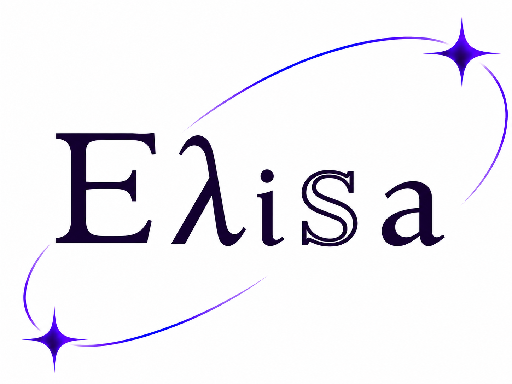

<p align="center">
  
</p>

<h1 align="center">Elisa compiler</h1>

<p align="center">
  <strong>A statically typed systems language with indentation-based syntax.</strong><br>
  Native executables, WebAssembly modules, and Python extensions.
</p>

<p align="center">
  <a href="#run-your-first-program"><strong>Quickstart</strong></a>
  &nbsp;·&nbsp;
  <a href="#elisa-by-example">Examples</a>
  &nbsp;·&nbsp;
  <a href="docs/">Documentation</a>
  &nbsp;·&nbsp;
  <a href="docs/development/">Contributing</a>
</p>

---

Elisa checks types, memory lifetimes, and effects before generating code. This repository contains **Stage1**, the self-hosted compiler written in Elisa. The Go compiler in [Elisa-core](https://github.com/torarinvik/Elisa-core), called **Stage0**, builds the first Stage1 binary. Stage1 can then compile Elisa programs and its own source.

## Elisa by example

<!-- GitHub's Linguist has no Elisa grammar. The python fences provide approximate highlighting for the Elisa snippets. -->

### Blocks that return a value

A block can produce a value. Here the last line of the indented block becomes
`total`, and `subtotal` and `shipping` stay local to that block.

```python
def order_total_cents(unit_price_cents: i64, quantity: i64) -> i64:
    total: i64 =
        subtotal: i64 = unit_price_cents * quantity
        shipping: i64 = 0 if subtotal >= 5000 else 499
        subtotal + shipping
    return total
```

### Loops that return a value

The loop starts `total` at zero, adds each number squared, and yields the final
total. The range `0..<limit` excludes `limit`, so `sum_of_squares(4)` returns `14`.

```python
def sum_of_squares(limit: i64) -> i64:
    result: i64 =
        for number in 0..<limit |total: i64 = 0| -> total:
            total += number * number
    return result
```

## Run your first program

### Bootstrap the compiler

These steps use Bash on macOS or Linux. Install Git, Go, Make, Python 3, LLVM development libraries with `llvm-config`, Clang, and Z3. The [Elisa-core build instructions](https://github.com/torarinvik/Elisa-core#build-the-compiler) cover platform-specific setup.

From a directory where you keep your projects, clone both repositories and build Stage0 first:

```sh
git clone https://github.com/torarinvik/Elisa-core.git
git clone https://github.com/torarinvik/Elisa-compiler.git
make -C Elisa-core/compiler build

cd Elisa-compiler
export ELISA_CORE="$(cd ../Elisa-core && pwd)"
export ELISACORE_BIN="$ELISA_CORE/compiler/bin/elisac"
scripts/elisac_stage1.sh --seed
```

Adjust `ELISA_CORE` if your Elisa-core checkout lives elsewhere. Set `LLVM_CONFIG` to the path of your chosen `llvm-config` if the wrapper picks up a different LLVM installation.

### Compile and run

The included [Hello, Elisa example](examples/hello.elisa) uses `extern` to declare the C function `puts`. The indented body of `main` prints a line and returns zero to indicate success.

```python
extern puts(message: cstr) -> i32

def main() -> i64:
    _ = puts("Hello, Elisa!")
    return 0
```

Compile and run it:

```sh
scripts/elisac_stage1.sh -emit exe -o build/hello examples/hello.elisa
./build/hello
```

```text
Hello, Elisa!
```

| To get | Use |
| --- | --- |
| A native executable | `-emit exe` |
| An object file | `-emit obj` |
| Readable LLVM IR | `-emit llvm` |

Run `scripts/install_stage1.sh` to install a snapshot as `elisac-stage1` under `~/.elisac`.

## Explore Elisa

- [Language style guide](STYLE_GUIDE.md) covers common syntax and idioms.
- [Python extensions](docs/interop/python.md) explains native modules and generated type stubs.
- [WebAssembly](docs/interop/wasm.md) shows how to export a function and call it from JavaScript.
- [Documentation index](docs/) links to language notes, compiler internals, and development guides.

## Find your way around the repository

| Path | Contents |
| --- | --- |
| [`examples/`](examples/) | Small programs you can compile and run |
| [`src/driver/`](src/driver/) | Command-line driver and build orchestration |
| [`src/lexer/`](src/lexer/), [`src/parser/`](src/parser/) | Source text, tokens, and syntax trees |
| [`src/semantic/`](src/semantic/), [`src/ir/`](src/ir/) | Semantic checks and intermediate representation |
| [`src/backend/`](src/backend/) | LLVM lowering and code generation |
| [`elisacore_std/`](elisacore_std/) | Standard library and runtime vendored from Elisa-core |
| [`scripts/`](scripts/), [`tools/`](tools/) | Build scripts and development utilities |
| [`test/`](test/) | Fixtures, regressions, parity tests, and benchmarks |

To check a seeded compiler, run `test/parity/stage1_product_smoke.sh`. For compiler changes, run the full parity suite with `test/parity/run_all.sh --profile full`. The suite uses Stage0 as a reference for comparing compiler behavior. See the [contributor guide](docs/development/README.md) for test prerequisites and runtime synchronization.
